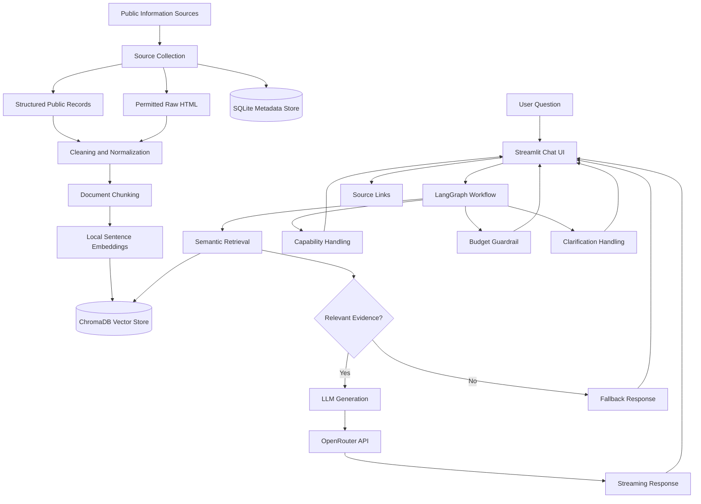

# DarGlobal & Wasalt AI Companion

An AI-powered real-estate information assistant that answers questions about DarGlobal's developments, company information, public announcements, and Wasalt's company background using a curated corpus of publicly available information.

The application combines **Retrieval-Augmented Generation (RAG)**, local semantic search, LangGraph-based workflow orchestration, and OpenRouter-hosted LLMs to provide grounded responses with source links.

🌐 **Live Application:** https://darglobal-ai-chatbot-cp3n.onrender.com  
💻 **GitHub Repository:** https://github.com/AriniRSM/darglobal-ai-chatbot

---

## Overview

The DarGlobal & Wasalt AI Companion allows users to ask natural-language questions about publicly available real-estate information.

Instead of relying entirely on an LLM's pretrained knowledge, the chatbot retrieves relevant information from an indexed knowledge base and uses those retrieved excerpts to generate responses.

The application is designed to:

- Answer questions about DarGlobal's company profile, developments, locations, and public announcements.
- Provide information about Wasalt's company background, platform services, and public licensing information.
- Retrieve relevant public-source information using semantic similarity.
- Provide source links for traceability.
- Handle unsupported questions gracefully rather than fabricating information.
- Distinguish publicly announced project information from live property availability and pricing.

---

## Live Application

**URL:** https://darglobal-ai-chatbot-cp3n.onrender.com

The application is deployed as a Docker-based web service on Render.

The landing page provides access to the chatbot interface, where users can ask questions, use suggested FAQs, and explore information from the indexed public-source corpus.

### Current Deployment Status

- Public application deployed and accessible.
- Streamlit landing page and chatbot interface available.
- Docker-based deployment configured.
- OpenRouter API integration configured.
- Source retrieval and chatbot workflow implemented.

---

# Architecture

The application follows a modular architecture separating data collection, preprocessing, indexing, retrieval, orchestration, LLM generation, and user interaction.



## Architectural Components

### 1. Data Collection

Public information is collected through structured records and conservative website inspection/crawling utilities.

The collection process is separate from chatbot inference. Users do not trigger website scraping when they ask questions.

### 2. Data Preprocessing

Collected records and permitted HTML content are cleaned and normalized before indexing.

The pipeline extracts relevant text and metadata, including source, URL, project name, location, category, and timestamps where available.

### 3. Document Chunking

Documents are divided into overlapping chunks using LangChain's `RecursiveCharacterTextSplitter`.

Current configuration:

- Chunk size: `850` characters
- Chunk overlap: `120` characters
- Start-index metadata enabled

### 4. Embeddings

Text is embedded locally using:

`sentence-transformers/all-MiniLM-L6-v2`

Embeddings are generated using Sentence Transformers on CPU and normalized before storage.

### 5. Vector Storage

The indexed corpus is stored in ChromaDB using cosine similarity.

Collection:

`darglobal_public_knowledge`

The vector database supports semantic retrieval of relevant document chunks based on user questions.

### 6. Retrieval

The retriever searches the local vector database for relevant chunks.

Current retrieval configuration:

- Top-k retrieval: `6`
- Default minimum relevance threshold: `0.48`
- Company-overview query threshold: `0.44`
- Recent user questions are incorporated into the retrieval query to support conversational follow-ups.

Retrieved chunks are filtered based on relevance before being passed to the generation workflow.

### 7. Workflow Orchestration

LangGraph orchestrates the chatbot's conditional workflow.

The workflow handles:

- Capability-related questions
- Budget/property recommendation guardrails
- Clarification requests
- Retrieval-based answering
- No-evidence fallback
- LLM generation

This avoids sending every question directly to the LLM and enables deterministic handling of certain types of queries.

### 8. LLM Generation

Grounded responses are generated through OpenRouter.

Configured model:

`openrouter/free`

The model can be changed through the `OPENROUTER_MODEL` environment variable.

The generation pipeline:

1. Receives the user question.
2. Receives relevant retrieved excerpts.
3. Receives conversational context where applicable.
4. Applies a grounding-oriented system prompt.
5. Generates a response.
6. Streams the response to the user interface.

The prompt instructs the model to avoid unsupported claims, invented prices, fabricated availability, and assumptions beyond the provided source material.

### 9. User Interface

The frontend is built using Streamlit.

Features include:

- Landing page
- Chat interface
- Suggested FAQ questions
- Streaming welcome message
- Streaming AI responses
- Session-based conversation history
- Source links
- Home/chat navigation
- Graceful error and fallback messages

Conversation history is maintained within the Streamlit session and is not persisted to a database.

---

# Technology Stack

| Component | Technology |
|---|---|
| Frontend | Streamlit |
| Programming Language | Python 3.11 |
| LLM Provider | OpenRouter |
| Configured Model Routing | `openrouter/free` |
| Workflow Orchestration | LangGraph |
| RAG Framework | LangChain |
| Document Chunking | LangChain Text Splitters |
| Embeddings | Sentence Transformers |
| Embedding Model | `all-MiniLM-L6-v2` |
| Vector Database | ChromaDB |
| Metadata Database | SQLite |
| HTTP Requests | Requests, HTTPX |
| HTML Parsing | BeautifulSoup |
| HTTP Caching | Requests-Cache |
| Containerization | Docker |
| Deployment | Render |
| Testing | Python unittest and custom chatbot evaluation |

---

# Public Data Sources

The chatbot uses a curated corpus of public-source records.

## DarGlobal

Sources include publicly available information from:

- Official DarGlobal corporate website
- Official project directory
- Public project pages
- Public announcements and news
- Publicly available project information
- DarGlobal news available through Quara Holding

Official sources:

- https://darglobal.co.uk/
- https://darglobal.co.uk/projects

Quara Holding public news:

- https://www.quaraholding.com/en/news

The corpus includes company information, project names, locations, publicly stated project details, and selected announcements.

Project information represents publicly reported information at the time of capture and should not be interpreted as confirmation of current availability.

## Wasalt

Wasalt information is sourced primarily from the public company profile maintained by Quara Holding.

Source:

- https://www.quaraholding.com/en/investments/wasalt

The corpus includes publicly described information such as:

- Company background
- Platform services
- Publicly reported user figures
- Licensing information
- General service categories

It does **not** include individual property listings.

## Real Estate General Authority (REGA)

The knowledge base includes publicly available REGA information:

- REGA platform/FAL directory information
- Public open-data catalog descriptions

The catalog contains descriptions and links to datasets, but the underlying downloadable statistical datasets are not included in the chatbot's indexed corpus.

---

# Data Collection and Ingestion

The data pipeline is separate from the application runtime.

## Collection

The scraping utilities support:

- Robots.txt inspection
- Sitemap discovery
- Bounded crawling
- URL filtering
- Retry handling
- Request caching
- Crawl delays
- Source inspection reports
- Structured extraction

The crawler uses a conservative approach and does not attempt to bypass anti-bot protections.

## Processing

The ingestion pipeline:

1. Reads structured public-source records and permitted raw HTML.
2. Extracts and cleans document content.
3. Normalizes source information.
4. Computes content hashes.
5. Skips unchanged content.
6. Splits documents into overlapping chunks.
7. Generates local embeddings.
8. Stores chunks in ChromaDB.
9. Tracks ingestion metadata in SQLite.

## Deduplication and Metadata

SQLite is used to track ingestion information including:

- Source URL
- Source name
- Processing status
- Content hash
- Scraped timestamp
- Indexed timestamp
- Chunk count
- Processing errors

Content hashes allow unchanged records to be skipped during subsequent ingestion runs.

---

# How the Chatbot Works

When a user submits a question:

1. The question is received by the Streamlit chat interface.
2. The LangGraph workflow determines how the question should be handled.
3. Relevant documents are retrieved from ChromaDB using semantic similarity.
4. Retrieval scores are checked against configured relevance thresholds.
5. Relevant excerpts are passed to the LLM.
6. OpenRouter generates a grounded response.
7. The response is streamed into the chat interface.
8. Relevant source links are displayed alongside the answer.

If the retrieved information is insufficient, the chatbot provides a fallback response instead of generating an unsupported answer.

---

# Guardrails and Reliability

The chatbot includes several safeguards.

### Grounded Generation

The LLM is instructed to answer using the supplied excerpts rather than relying on unsupported pretrained knowledge.

### No Fabricated Property Availability

The chatbot does not claim that a property is currently available for sale or rent unless such information is explicitly supported by the indexed data.

### No Fabricated Pricing

The chatbot does not invent current prices or match a user's budget to currently available properties without verified pricing and availability.

### Relevance Filtering

Retrieved chunks are filtered by relevance thresholds to reduce the chance of answering from unrelated information.

### Source Selection

Sources are selected based on their relevance to the retrieved evidence, with a configurable maximum number of cited sources.

### Graceful Failure

Provider errors and generation failures are handled through user-safe fallback messages.

---

# Limitations

## No Live Property Inventory

The chatbot does not connect to live property listing databases or inventory APIs.

It cannot verify:

- Current property availability
- Units currently for sale
- Units currently for rent
- Real-time booking status
- Current listing status

## No Current Unit Pricing

The chatbot does not have a live pricing feed.

It cannot reliably:

- Compare currently available properties by price
- Recommend properties based on a current budget
- Confirm the price of an individual unit
- Verify current promotions or offers

## Wasalt Listings Are Excluded

Individual Wasalt listings and auction records are not included in the indexed corpus.

Wasalt's published terms restrict automated extraction and copying/republication of website materials. The project does not bypass these restrictions.

An authorized data feed or appropriate permission would be required to add listing-level data.

## Limited Underlying REGA Datasets

The indexed REGA records include catalog descriptions and source links.

The underlying downloadable statistical datasets are not ingested, so the chatbot cannot perform detailed analysis of those datasets.

## Website Access Restrictions

Direct DarGlobal website crawling may encounter anti-bot or access-control interstitials.

The crawler does not attempt to circumvent these protections. Source-linked public records are used where available.

## Static Knowledge Corpus

The chatbot's knowledge reflects the indexed information available at the time the records were captured.

It is not automatically updated in real time.

New projects, announcements, prices, availability, or company information may not yet be reflected.

## LLM Variability

The application uses OpenRouter's free model routing.

Model selection and provider availability may vary. Different free models may produce variations in answer style, reasoning, and quality.

## Free-Tier API Limitations

OpenRouter free models are subject to rate limits and availability restrictions.

During development, the daily free-model request quota was exhausted, resulting in HTTP `429` responses. This temporarily prevented end-to-end AI response testing.

The application does not require paid model credits, but successful inference depends on the availability of free models and the applicable free-tier quotas.

## Session-Only Conversation History

Conversation history is maintained within the Streamlit session.

It is not permanently stored, and returning Home resets the current conversation.

## Deployment Constraints

The application is deployed using a free Render service.

Free-tier hosting may have limitations including:

- Service inactivity and cold starts
- Limited CPU and memory
- Deployment/build time
- Ephemeral filesystem behavior

The vector index is built as part of the Docker image from the committed corpus to support deployment.

---

# Running Locally

## Prerequisites

- Python 3.11 or newer
- Git
- An OpenRouter API key
- Internet connectivity for API requests and initial embedding model download

## Clone the Repository

```bash
git clone https://github.com/AriniRSM/darglobal-ai-chatbot.git
cd darglobal-ai-chatbot
```

## Create a Virtual Environment

```bash
python3 -m venv .venv
```

Activate it:

### macOS/Linux

```bash
source .venv/bin/activate
```

## Install Dependencies

```bash
python3 -m pip install --upgrade pip
pip install -r requirements.txt
```

## Configure Environment Variables

Create a `.env` file in the project root.

```dotenv
OPENROUTER_API_KEY=your_openrouter_api_key
OPENROUTER_MODEL=openrouter/free

CHROMA_PATH=chroma_db
METADATA_DB=data/metadata.sqlite3

EMBEDDING_MODEL=sentence-transformers/all-MiniLM-L6-v2
```

Never commit the `.env` file or expose API keys.

## Build or Refresh the Knowledge Base

```bash
python3 -m app.ingestion.pipeline
```

## Run the Streamlit Application

From the project root:

```bash
PYTHONPATH=. python3 -m streamlit run app/main.py
```

The application is generally available at:

http://localhost:8501

---

# Data Refresh Commands

The collection and indexing pipeline can be executed independently of the chatbot.

## Inspect Source Policies

```bash
python3 main.py inspect
```

## Run Bounded Crawling

```bash
python3 main.py crawl --max-pages 30 --delay 1.0
```

## Run Structured Extraction

```bash
python3 -m app.scraper.structured --source all --limit 30 --delay 1
```

## Rebuild the Index

```bash
python3 -m app.ingestion.pipeline
```

Review generated reports and source records before indexing or using newly collected data.

Collection must remain compliant with each source website's access rules, terms, and reuse permissions.

---

# Docker

## Build the Docker Image

```bash
docker build -t darglobal-ai-assistant .
```

## Run Locally

```bash
docker run --rm \
  -p 8501:10000 \
  -e OPENROUTER_API_KEY="your_openrouter_api_key" \
  darglobal-ai-assistant
```

Open:

http://localhost:8501

The Docker image:

- Uses Python 3.11
- Installs the project dependencies
- Installs CPU-only PyTorch
- Downloads the embedding model during image build
- Copies the source corpus
- Builds the ChromaDB index during image construction
- Runs Streamlit on the container port `10000`

The application can be configured through environment variables.

---

# Deployment

The application is deployed on Render using Docker.

### Live URL

https://darglobal-ai-chatbot-cp3n.onrender.com

### Deployment Configuration

The deployment configuration is defined in:

- `Dockerfile`
- `render.yaml`

The Render service uses:

- Docker runtime
- Free plan
- Streamlit
- Port configuration through the `PORT` environment variable
- Health check path: `/_stcore/health`

### Environment Variables

The API key must be configured as a secret in the Render service environment.

| Variable | Purpose |
|---|---|
| `OPENROUTER_API_KEY` | OpenRouter authentication |
| `OPENROUTER_MODEL` | Model routing configuration |
| `CHROMA_PATH` | ChromaDB persistence path |
| `METADATA_DB` | SQLite metadata path |
| `EMBEDDING_MODEL` | Sentence-transformer model |

---

# Testing

## Unit Tests

Run the unit test suite:

```bash
python3 -m unittest discover -s tests -v
```

## Chatbot Evaluation

Run the question-based evaluation:

```bash
python3 -m tests.evaluate_chatbot
```

The evaluation runner checks chatbot responses against predefined evaluation cases, including:

- Expected answer terms
- Expected source count
- Expected source URL
- Expected source domain

The evaluation requires:

- A built local ChromaDB index
- A configured OpenRouter API key
- Availability of the configured model route

The evaluation uses LLM-generated answers, so results may vary depending on the free model selected by OpenRouter.

---

# Project Structure

```text
darglobal-ai-chatbot/
│
├── app/
│   ├── main.py
│   │
│   ├── scraper/
│   │   ├── common.py
│   │   ├── darglobal.py
│   │   ├── wasalt.py
│   │   ├── pipeline.py
│   │   └── structured.py
│   │
│   ├── ingestion/
│   │   ├── cleaner.py
│   │   ├── embedder.py
│   │   ├── pipeline.py
│   │   └── sources.py
│   │
│   ├── rag/
│   │   └── retriever.py
│   │
│   ├── workflow/
│   │   └── graph.py
│   │
│   ├── llm/
│   │   └── openrouter.py
│   │
│   └── database/
│       └── metadata_store.py
│
├── data/
│   └── scraped/
│       ├── darglobal_verified_pages.jsonl
│       ├── darglobal_quara_news.jsonl
│       ├── darglobal.jsonl
│       ├── wasalt.jsonl
│       ├── rega_fal_platform_directory.jsonl
│       ├── rega_catalog.jsonl
│       └── README.md
│
├── tests/
│   ├── evaluation_cases.json
│   ├── evaluate_chatbot.py
│   └── ...
│
├── Dockerfile
├── render.yaml
├── requirements.txt
├── README.md
└── main.py
```

---

# Future Improvements

Potential improvements include:

- Authorized live property feeds and listing APIs
- Live pricing and availability integration
- Authorized Wasalt listing ingestion
- Integration of underlying REGA datasets for analytical queries
- Hybrid retrieval combining semantic search and keyword retrieval
- Improved reranking
- Automated scheduled corpus refresh
- Persistent conversation history
- Expanded automated evaluation datasets
- Monitoring and observability for model/provider failures
- Alternative LLM providers and model fallback strategies
- Improved caching of model responses
- More granular source freshness tracking

---

# Disclaimer

This chatbot is an experimental AI-powered information assistant developed using publicly available information.

It is not an official DarGlobal or Wasalt product and is not affiliated with, endorsed by, or operated by either company.

Information may be incomplete, outdated, or inaccurate. Users should verify important information through the original source websites and contact the relevant company for current property details, pricing, availability, legal, or investment information.

The chatbot does not provide financial, investment, legal, or property purchasing advice.

---

## Author

**Arini RSM**

GitHub: https://github.com/AriniRSM

Project repository: https://github.com/AriniRSM/darglobal-ai-chatbot

Live application: https://darglobal-ai-chatbot-cp3n.onrender.com
